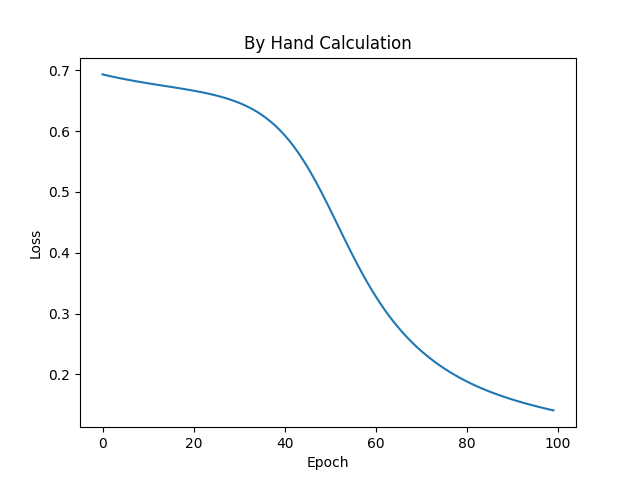
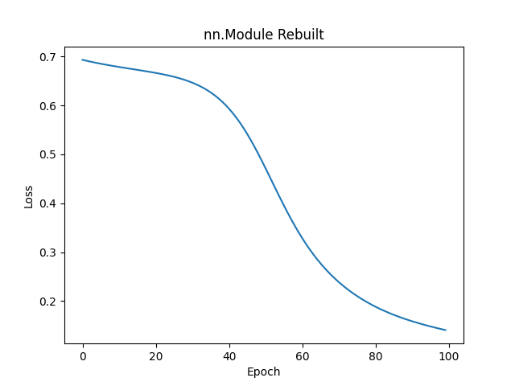

# Breast Cancer Neural Network Classifier

A small binary classifier on the scikit-learn breast cancer dataset where
every gradient is derived and implemented by hand, verified against PyTorch
autograd, and cross-checked against an idiomatic `nn.Module` + optimiser
version.

**Result:** 98.2% test accuracy (112/114 test samples). The hand-written and
`nn.Module` versions print the same loss at every one of 100 epochs.

## Problem

A colleague has asked for a small classifier on a real table of data, and they
have one concern: they do not trust a result they cannot explain. Frameworks
hide a lot, and "it trains" is not evidence that it is right. So they want to
see the machinery.

You are to build a small neural network classifier in which the gradients are
computed by you, by hand, rather than by the framework. Then you prove those
gradients are correct by checking them against autograd. Then you rebuild the
same classifier the idiomatic way, with `nn.Module` and an optimiser, and show
that the two versions agree with each other. Finally, you package it, test it
and train it on a real dataset, so that someone else can pick it up, run it and
get your numbers.

<table>
  <tr>
    <td align="center"><br>By hand</td>
    <td align="center"><br>nn.Module</td>
  </tr>
</table>
---

## Results

| Version                 | Final train loss | Test accuracy |
|-------------------------|------------------|---------------|
| Manual gradients        | 0.14094          | 0.9825        |
| `nn.Module` + optim     | 0.14094          | 0.9825        |
| Majority-class baseline | <loss or n/a>    | <x>           |

- Gradient check (hand-written vs autograd, float32): `dW1`, `db1`, `dW2` and
  `db2` all pass within `rtol=1e-5, atol=1e-8`.
- Test suite: 6 tests, all passing (Python 3.12.6, Windows)

## What this project does

1. **Manual backprop:** forward pass, loss and gradients written by hand.
2. **Gradient check:** manual gradients compared to autograd per parameter.
3. **Idiomatic rebuild:** same model with `nn.Module` and an optimiser.
4. **Agreement:** both trained from identical init and seed, then compared.
5. **Packaging:** pinned Python version, tested, CI, reproducible commands.

## Data

- **Source:** scikit-learn `load_breast_cancer`.
- **Size:** 569 samples, 30 numeric features, 2 classes (malignant / benign).
- **Split:** 80/20, seed 42: 455 train, 114 test. There is no validation set.
- **Preprocessing:** `StandardScaler`, fitted on the training set only and
  applied to the test set.
- **Class balance (test set):** `<n malignant / n benign>`.

## How it works

The model is a two-layer network for binary classification:
`Linear(30→8) → ReLU → Linear(8→1) → Sigmoid`, trained with binary
cross-entropy. Weights start as small random values (×0.01, seed 0) and
biases at zero.

Shapes: $X \in \mathbb{R}^{N\times 30}$, $W_1 \in \mathbb{R}^{30\times 8}$,
$b_1 \in \mathbb{R}^{8}$, $W_2 \in \mathbb{R}^{8\times 1}$, $b_2 \in \mathbb{R}$,
where $N$ is the number of samples in the batch.

### 1. Forward pass (`forward`)

$$z_1 = XW_1 + b_1 \qquad a_1 = \max(0, z_1)$$
$$z_2 = a_1 W_2 + b_2 \qquad \hat{y} = \sigma(z_2) = \frac{1}{1+e^{-z_2}}$$

- The first layer mixes the 30 features into 8 hidden values, and ReLU zeroes
  the negative ones.
- The second layer combines those 8 values into one number, and the sigmoid
  turns it into a probability $\hat{y} \in (0,1)$ of class 1.
- A sample is predicted as class 1 when $\hat{y} > 0.5$.

### 2. Loss (`bce`)

$$L = -\frac{1}{N}\sum_{i=1}^{N}\Big[y_i\log \hat{y}_i + (1-y_i)\log(1-\hat{y}_i)\Big]$$

- Binary cross-entropy: large when the model is confident and wrong, near
  zero when it is confident and right. It fits a sigmoid output because the
  dataset has two classes.
- $\hat{y}$ is clamped to $[10^{-7},\,1-10^{-7}]$ so $\log 0$ never occurs.
- With small random starting weights $\hat{y}\approx 0.5$, so the loss starts
  near $\ln 2 \approx 0.693$, which matches epoch 0 of the training output.

### 3. Backward pass (`backward`)

**Where `dz2` comes from.** Take the loss
$L = -\frac{1}{N}\sum_i \big[y_i\log\hat y_i + (1-y_i)\log(1-\hat y_i)\big]$.

1. Differentiate the loss with respect to the prediction:
$$\frac{\partial L}{\partial \hat y_i} = -\frac{1}{N}\left(\frac{y_i}{\hat y_i} - \frac{1-y_i}{1-\hat y_i}\right) = \frac{1}{N}\cdot\frac{\hat y_i - y_i}{\hat y_i(1-\hat y_i)}$$
2. Differentiate the sigmoid $\hat y_i = \sigma(z_{2,i})$:
$$\frac{\partial \hat y_i}{\partial z_{2,i}} = \hat y_i(1-\hat y_i)$$
3. Multiply them (chain rule). The $\hat y_i(1-\hat y_i)$ factors cancel:
$$dz_{2,i} = \frac{\partial L}{\partial z_{2,i}} = \frac{\hat y_i - y_i}{N}$$

The $1/N$ comes from the mean in the loss, so every gradient below this line
is already averaged over the batch.

**Every gradient, with its shape and the line that computes it:**

| Gradient | Formula | Shape | Code (`classifier/main.py`) |
|---|---|---|---|
| `dz2` | $(\hat y - y)/N$ | (N, 1) | line 54: `dz2 = (y_hat - y) / y.shape[0]` |
| `da1` | $dz_2 W_2^{\top}$ | (N, 8) | line 55: `da1 = dz2 @ W2.T` |
| `dz1` | $da_1 \odot \mathbf{1}[z_1>0]$ | (N, 8) | line 56: `dz1 = da1 * (z1 > 0).float()` |
| `dW2` | $a_1^{\top} dz_2$ | (8, 1) | line 57: `dW2 = a1.T @ dz2` |
| `db2` | $\sum_n dz_2$ | (1,) | line 58: `db2 = torch.sum(dz2, dim=0)` |
| `dW1` | $X^{\top} dz_1$ | (30, 8) | line 59: `dW1 = X.T @ dz1` |
| `db1` | $\sum_n dz_1$ | (8,) | line 60: `db1 = torch.sum(dz1, dim=0)` |

Each weight gradient has the same shape as its weight, which is a quick
sanity check on the transposes.

### 4. Parameter update

$$W \leftarrow W - \eta\,dW \qquad b \leftarrow b - \eta\,db$$

for each of $W_1, b_1, W_2, b_2$, with learning rate $\eta = 0.1$. This
repeats for 100 epochs on the full training set: forward, loss, backward,
update.

### 5. How the gradients are verified

Both checks are automated tests (`pytest`):

- **Hand-written vs autograd** (`test_gradients_vs_autograd`): on 16 training
  samples from a fresh initialisation, `dW1, db1, dW2, db2` match PyTorch
  autograd's `.grad` within `rtol=1e-5, atol=1e-8` (float32).
- **Hand-written vs `nn.Module`** (`test_starting_value`, `test_5_epoch_run`):
  both versions start from identical weights. Over 5 full-batch epochs, the
  predictions, loss, gradients and updated weights are asserted equal at every
  step (`torch.testing.assert_close`, PyTorch's default float32 tolerances).
  The 100-epoch loss logs from the two training scripts also agree to about
  1e-7 per epoch, but that comparison was read from the printed output, not
  asserted in a test.

**Tolerances and why**

Gradient check: `rtol=1e-5, atol=1e-8`, the `torch.allclose` defaults, written
out in the test so they are visible. `rtol` bounds the relative error on large
entries and `atol` the absolute error on entries near zero. The check passes
at these defaults, so no loosening was needed.

Agreement test: PyTorch's `assert_close` defaults for float32, unchanged. I
tried float64 first, but it made the agreement test fail, so both versions
stay float32.

### What the framework hides

`loss.backward()` performs the table in step 3 for you. Doing it by hand
shows three things that are otherwise invisible: the sigmoid and BCE
cancellation, the transposes that make the matrix shapes line up, and that
ReLU only passes gradient where $z_1>0$.

## Reproduce

Run everything from the project folder.

### 1. Install

Requires **Python 3.12**. Check with `python --version`. If you don't have it,
download it from https://www.python.org/downloads/ (on Windows, tick
"Add python.exe to PATH" in the installer).

Open a terminal in the project folder, then run the commands for your system.

**Windows (PowerShell or Command Prompt)**
```bash
py -3.12 -m venv .venv
.venv\Scripts\activate
```

**Windows (Git Bash)**
```bash
py -3.12 -m venv .venv
source .venv/Scripts/activate
```

**macOS / Linux**
```bash
python3.12 -m venv .venv
source .venv/bin/activate
```

Then, on every system:
```bash
python -m pip install --upgrade pip
pip install torch --index-url https://download.pytorch.org/whl/cpu
pip install -r requirements.txt
```

Check that it worked:
```bash
python -c "import torch; print(torch.__version__)"
```
You should see a version number with no errors. No GPU is needed. From here
on, keep the environment active (you should see `(.venv)` at the start of the
terminal line).

### 2. Smoke training run (a few seconds)

```bash
python -m classifier.main --train --smoke --out runs/smoke.pt
```

Trains 5 epochs on 32 samples and saves `runs/smoke.pt`. Nothing is printed.
It passed if the command returns without an error and the file exists.

### 3. Full training

```bash
python -m classifier.main --train --out runs/model.pt
```

Trains 100 epochs on the 455 training samples and saves `runs/model.pt`.
This takes a few seconds on a laptop CPU.

To watch the loss for every epoch, run `python -m classifier.main` with no
flags. It prints the loss and test accuracy, then opens a plot (close the
window to finish). The `nn.Module` version is:

```bash
python -m classifier.auto_main
```

Both should print the same losses (last digits may differ), ending in
`Epoch 99 Loss 0.1409...` and `Test acc: 0.9824...`.

### 4. Publish the checkpoint

The trained checkpoint is published at:

"https://github.com/hev-iban/Classifier/releases/download/1.0.0/model.pt"


### 5. Evaluate

```bash
python -m classifier.main --evaluate --checkpoint runs/model.pt --metrics-out runs/metrics.json
```

Prints the test accuracy and writes it to `runs/metrics.json`. Expected:
`Test acc: 0.9824...` (112 of 114 test samples).

### 6. Run the tests

```bash
pytest
```

Expected: `6 passed` in about 4 s. You will also see about 14
`PyparsingDeprecationWarning` messages from matplotlib. They are harmless.

- `test_gradient_vs_autograd.py` (1 test): hand-written gradients match
  autograd.
- `test_agreement.py` (2 tests): hand-written and `nn.Module` versions start
  from the same weights and stay identical over 5 epochs.
- `test_load_data.py` (3 tests): shapes.

All tests should pass:

- `test_gradient_vs_autograd.py`: hand-written gradients match autograd.
- `test_agreement.py`: hand-written and `nn.Module` versions start from the
  same weights and stay identical over 5 epochs.
- `test_load_data.py`: shapes.

### Optional: record the train/test split

```bash
python -m classifier.main --split --out runs/split.json
```

Writes the sample indices of the 80/20 split (seed 42) for reference.

## Repository layout

```
classifier/        the code
  main.py          hand-written forward, loss, backward, training
  auto_main.py     the same model with nn.Module and an optimiser
tests/
  test_gradient_vs_autograd.py
  test_agreement.py
  test_load_data.py
docs/              Figures
.github/           CI workflow (runs pytest)
pyproject.toml     Python version, dependencies, test settings, reproduce commands
requirements.txt   dependencies for pip install
LICENSE            MIT LICENCE
```


## Limitations

- **No validation set.** The data is split 80/20 into train (455) and test
  (114) only. Training prints training loss, so this run cannot show whether
  the model is overfitting. Learning rate (0.1), hidden size (8) and epochs
  (100) were set by hand rather than chosen on held-out data, and the
  learning rate was not swept.
- **The checkpoint is picked by training loss, not validation loss.** `train`
  keeps the weights with the lowest training loss. Full-batch gradient
  descent lowers the loss every epoch, so this always selects the last epoch.
  It would keep doing so even if the model were overfitting, so it is not
  real model selection. The weights are also saved before that epoch's
  update, so the evaluated weights have had 99 updates, not 100.
- **The gradient check runs in float32 only, with no float64 comparison.**
  The tolerances are the `torch.allclose` defaults (`rtol=1e-5, atol=1e-8`).
  Float32 carries about 7 significant digits, while float64 carries about 16
  and would allow a tolerance near 1e-10, so a float64 run would make any
  remaining mismatch point to a real error (such as the probability clamp)
  rather than rounding. That comparison has not been run.


## AI use

**Claude (Anthropic):** used as an assistant for explanations and documentation.
- Explaining concepts in simple terms before I wrote the code: the forward
  pass, the loss (BCE), the backward pass, softmax, and the
  `load_breast_cancer`, `load_wine` and `load_digits` datasets.
- Drafting and formatting this README, including the install and reproduce
  steps and the formulas in "How it works".

**Gemini (Google):** used as a tutor, a review tool and for boilerplate.
- Tutor: explained concepts I was not familiar with. I told it not to give me
  code when I used it this way.
- Syntax review of my code.
- Boilerplate: the CI workflow (`.github/`) and `argparse` command-line
  handling in `classifier/main.py`.

**<Claude / Gemini>, tolerances:** explained what `rtol` and `atol` mean and
what values suit float32. I kept the `torch.allclose` defaults for the
gradient check because they pass. I also tried float64 first, but it made the
agreement test fail, so I stayed with float32.

**Not used for:** writing the core of the project. I wrote the forward pass,
loss, backward pass, training loop and the gradient and agreement tests
myself.